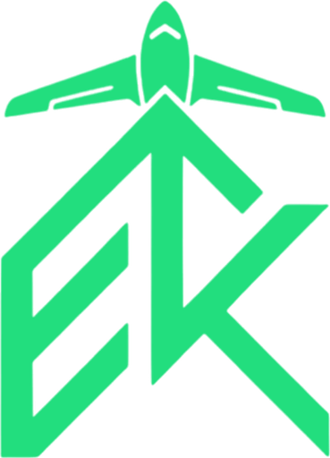

<div align="center">



# EgyKode / Pilot

**The Intelligent Cloud DevOps Compiler.**

Turn application source code into an explained, cost-aware, editable, validated, and safely deliverable Cloud DevOps implementation.

**[pilot.egykode.com](https://pilot.egykode.com)** · [EgyKode company](https://egykode.com) · [EgyKode Academy](https://academy.egykode.com) · [The Five Questions](#-the-five-questions-pilot-answers) · [Trust Vocabulary](#-trust--status-vocabulary) · [Pipeline](#-the-end-to-end-compiler-pipeline) · [Infrastructure](#-production-infrastructure) · [Quick Start](#-quick-start)

[](https://pilot.egykode.com)
[](https://egykode.com)
[](LICENSE)


</div>

---

EgyKode Pilot inverts the traditional cloud journey. Instead of forcing developers to become full-time cloud architects reading thousands of pages of cloud documentation just to run their application, Pilot starts where engineers live: **in their source code**.

```
Source code or repository (Local Folder or Git)
        ↓
Evidence-based scan (Zero-egress static AST parsing)
        ↓
Production requirements & constraints
        ↓
Costed architecture options (AWS Fargate, EKS, RDS, SQS)
        ↓
DevOps tool selection & file generation
        ↓
In-browser IDE manual review & editing
        ↓
Automated validation (Syntax, linting, security guardrails)
        ↓
Safe delivery (Local folder, ZIP bundle, or Git Pull Request)
        ↓
Day-2 read-only operations & drift visibility
```

---

## 🎯 The Canonical Reasoning Model: The Five Questions EgyKode Pilot Answers

| # | Step & Mechanism | Core Question | Pilot Analysis | Verified Result |
|---|---|---|---|---|
| **01** | **Understand the Application**<br>`LOCAL-FIRST ANALYSIS` | **What did I build?** | Analyzes source code and deployment evidence to understand the application as real production workloads — identifying languages, frameworks, runtimes, services, dependencies, ports, health checks, build commands, background jobs, databases, queues, storage, and DevOps config. | A verified picture of what the application actually is. |
| **02** | **Understand the Intent**<br>`PRODUCTION REQUIREMENTS` | **What does it need to handle in production?** | Turns business and production requirements into explicit constraints — expected traffic, concurrency, availability, latency, growth, budget, security, data requirements, disaster recovery, operational preferences, cloud, and region. | A measurable definition of what the architecture must achieve. |
| **03** | **Find the Best-Fit Architecture**<br>`FEASIBILITY + OPTIMIZATION` | **What architecture should run it?** | Evaluates feasible architecture compositions against workloads, requirements, provider capabilities, organizational policies, and cost — eliminating impossible options first, then comparing remaining choices across cost, performance, availability, security, scalability, and complexity. | The best feasible architecture for actual requirements and budget — with trade-offs and reasoning visible. |
| **04** | **Turn the Decision into a System**<br>`CANONICAL BLUEPRINT + GENERATION` | **What exactly needs to exist?** | Converts selected architecture into a canonical blueprint, then generates infrastructure and operational artifacts — compute, networking, storage, databases, IAM, secrets, containers, K8s/ECS, Terraform, CI/CD, security, observability, backups, documentation, and runtime config. | One architecture decision translated into a complete, traceable Cloud DevOps project. |
| **05** | **Prove it Before Delivery**<br>`VALIDATION + HUMAN CONTROL` | **Can I trust what Pilot created?** | Validates the exact reviewed project for structural correctness, infrastructure consistency, security, cross-file dependencies, cost alignment, and available tool checks — then presents changes for review under explicit human approval. | A validated, reviewable project that is ready to deliver — without hidden changes or unverified claims. |

---

## ⚖️ Trust & Status Vocabulary

Pilot strictly separates facts, calculations, estimates, and unavailable data. It never silently converts unknown costs to zero or presents an AI assumption as a detected fact:

| Label | Definition in Pilot |
|---|---|
| **`Detected`** | Proven by a concrete file, dependency, manifest, or source code declaration. |
| **`Inferred`** | Suggested from indirect architectural cues or topological heuristics. |
| **`Verified cost rate`** | Retrieved from the cloud provider Price List API for the exact resource and region. |
| **`Calculated`** | Deterministic arithmetic over a verified rate card snapshot. |
| **`Estimated`** | Sized based on user-declared RPS, throughput assumptions, or regional uplift. |
| **`Local`** | Processed entirely on the user's workstation with zero network egress. |
| **`Connected`** | An active, verified cloud provider or Git identity was reached via CLI. |

---

## 📊 What is in the repository today

| Surface | Scope & Implementation |
|---|---|
| **21 Interactive Product Scenes** | Complete walkthrough covering the entire developer journey from AST parsing to Day-2 operations |
| **AST & Signal Extraction** | Static recognition for FastAPI, Express, NestJS, Go Gin, Python, Node.js, Dockerfiles, and Helm charts |
| **Topological Intelligence** | 6 distinct application archetypes matched deterministically (Web APIs, Queue Consumers, Batch, SPA, Cache, Brownfield) |
| **Real-Time FinOps Matrix** | Mathematical cost estimation using AWS US-East-1 catalog pricing with slider-driven monthly budget constraints |
| **Interactive In-Browser IDE** | High-fidelity code viewer supporting Terraform HCL, AWS CDK (TypeScript), and K8s YAML with live review overrides |
| **Safe Delivery Boundaries** | 3 non-destructive export flows: Write to local disk, download offline ZIP bundle, or open a GitHub Pull Request |
| **Adaptive Dual-Theme System** | Precision Dark Mode (`#07090b`) and Eye-Comfort Light Mode (`#f6f8fa`) with instantaneous token switching |
| **Responsive Mobile Architecture** | Native-feeling touch UX: segmented pill switchers, horizontal conduit steppers, and single-line status telemetry |

---

## ✨ Architectural Invariants

Pilot is built on four non-negotiable architectural invariants:

### 1. 🔒 Local by Default (Zero-Egress Static Analysis)
Static AST analysis runs entirely in place on your workstation. No proprietary code, credentials, configuration files, or business logic leave your machine.

### 2. 📐 Deterministic Rules, Never Guesses
Infrastructure topology, component sizing, and cost estimations rely on strict mathematical formulas and verified cloud provider rate cards — eliminating hallucinations and phantom architecture.

### 3. 🛡️ Brownfield Preservation
Pilot never bulldozes your team's existing investments. If your project already contains battle-tested Dockerfiles, Docker Compose setups, or Helm charts, Pilot incorporates them directly into the target cloud topology.

### 4. 🚦 Strict Human Approval Gate
Nothing is provisioned automatically without explicit developer consent. Pilot outputs pure, auditable Infrastructure as Code via local disk export, offline ZIP, or Git Pull Request for team code review.

---

## 🚀 The End-to-End Compiler Pipeline

```
[ Step 01: Ingestion ]    → [ Step 02: Topology ]     → [ Step 03: Architecture ]
  Local Folder or Git        Workloads & Invariants      Best-Fit Cloud Archetypes
        ↓                           ↓                                ↓
[ Step 04: FinOps ]       → [ Step 05: Emission ]     → [ Step 06: Delivery ]
  Deterministic Cost         Multi-Format IaC Code       Local / ZIP / GitHub PR
```

1. **Step 01 · Source Ingestion:** Open local project directory on disk or clone a private Git repository for inspection.
2. **Step 02 · Workloads Discovered:** Extract runtime ports, dependencies, health probes, background workers, and databases.
3. **Step 03 · Best-Fit Architecture:** Deterministic rule-matching synthesizes the optimal cloud architecture (e.g., AWS ECS Fargate + RDS + SQS).
4. **Step 04 · Deterministic Cost Calculation:** Computes itemized monthly operational spend against user-defined budget thresholds.
5. **Step 05 · Multi-Format IaC Generation:** Generates production-ready Terraform modules, AWS CDK stacks, or Kubernetes manifests.
6. **Step 06 · Safe Delivery Boundary:** Commits code to disk, downloads an offline bundle, or opens a pull request with complete architectural explanation.

---

## 🏛️ Architecture & Technology Stack

- **Core Framework:** [React 18](https://react.dev/) + [TypeScript](https://www.typescriptlang.org/) (Strict Mode)
- **Build System:** [Vite 6](https://vite.dev/) with tree-shaking and gzip asset pre-compression
- **Styling & Design System:** [Tailwind CSS](https://tailwindcss.com/) with tailored CSS custom properties for dual-theme rendering
- **Iconography:** [Lucide React](https://lucide.dev/)
- **Hosting & CDN:** [AWS S3](https://aws.amazon.com/s3/) + [Amazon CloudFront](https://aws.amazon.com/cloudfront/) with Origin Access Control (OAC)
- **DNS & Edge Security:** [Cloudflare](https://www.cloudflare.com/) (DNS Only, Grey Cloud) + AWS Certificate Manager (ACM TLS 1.2/1.3)
- **CI/CD Pipeline:** [GitHub Actions](https://github.com/features/actions) with AWS IAM OpenID Connect (OIDC) federation

---

## 🧭 Production Infrastructure

| Component | Target / Value | Status |
|---|---|---|
| **Live URL** | [https://pilot.egykode.com](https://pilot.egykode.com) | ✅ Operational (HTTPS 200 OK) |
| **AWS S3 Bucket** | `egykode-pilot-site-production` (`us-east-1`) | ✅ Private, AES-256, Block Public Access |
| **CloudFront Distribution** | `E1B9ABGRU6B07Q` (`d3m4yxqc8u95tp.cloudfront.net`) | ✅ OAC enabled, PriceClass 200, HTTP→HTTPS redirect |
| **SSL/TLS Certificate** | AWS ACM `112527a1-c606-4e58-833a-dcc4b4ff8d30` | ✅ Issued (`pilot.egykode.com`) |
| **Cloudflare DNS** | CNAME `pilot.egykode.com` → CloudFront | ✅ DNS-Only (`proxied: false`) |
| **CI/CD Role** | `arn:aws:iam::991216470475:role/egykode-pilot-github-deploy` | ✅ Keyless OIDC authentication |
| **EgyKode company site** | [egykode.com](https://egykode.com) | ✅ Commercial company site |
| **Academy site** | [academy.egykode.com](https://academy.egykode.com) | ⏳ Target after the domain cutover |

---

## 🏁 Quick Start

### Prerequisites
- Node.js 18+ (Node 20+ recommended)
- npm or pnpm

### 1. Clone & Install
```bash
git clone https://github.com/EgyKode/EgyKode-Pilot-Web.git
cd EgyKode-Pilot-Web
npm install
```

### 2. Development Server
```bash
npm run dev
# Server running at http://localhost:5173
```

### 3. Production Build
```bash
npm run build
# Compiles TypeScript and builds optimized bundle into dist/
```

### 4. Local Preview
```bash
npm run preview
# Serves the production build locally at http://localhost:4173
```

---

## 🚢 Continuous Deployment (CI/CD)

Deployments are automated through GitHub Actions ([`.github/workflows/deploy.yml`](.github/workflows/deploy.yml)).

Every push to `main` triggers:
1. TypeScript strict type-checking and Vite production build (`npm run build`).
2. Keyless authentication with AWS using **OpenID Connect (OIDC)** via role `egykode-pilot-github-deploy`.
3. S3 static sync:
   - Immutable assets (`dist/assets/*`) synced with `Cache-Control: public,max-age=31536000,immutable`.
   - Entry files (`dist/index.html`) synced with `Cache-Control: public,max-age=0,must-revalidate`.
4. CloudFront edge cache invalidation (`/*`) across all global PoPs.

---

## 📁 Repository Structure

```
egykode-pilot-web/
├── .github/
│   └── workflows/
│       └── deploy.yml            # Automated AWS S3 + CloudFront OIDC pipeline
├── public/
│   ├── brand/
│   │   ├── pilot-mark.png        # EgyKode Pilot official emblem
│   │   └── mark.svg              # Vector brand mark
│   └── favicon.ico               # Browser favicon
├── src/
│   ├── components/
│   │   ├── common/               # Reusable UI surfaces
│   │   │   ├── IdeCodeViewer.tsx # Interactive code editor with live overrides
│   │   │   ├── ProductWindow.tsx # Window frame container with traffic dots
│   │   │   └── SectionHeader.tsx # Scene header with step pill & typography
│   │   ├── layout/
│   │   │   ├── Navigation.tsx    # Header with theme toggle & brand lockup
│   │   │   └── Footer.tsx        # Footer with principles & platform links
│   │   └── sections/             # The 21 product demonstration scenes
│   │       ├── HeroSection.tsx
│   │       ├── ProblemSection.tsx
│   │       ├── MagicMomentSection.tsx
│   │       ├── UnderstandSection.tsx
│   │       ├── BusinessIntentSection.tsx
│   │       ├── ArchitectureDesignSection.tsx
│   │       ├── CostAwareSection.tsx
│   │       ├── GenerateSection.tsx
│   │       ├── DeliverySection.tsx
│   │       ├── PathToGreenSection.tsx
│   │       ├── ValidationSection.tsx
│   │       ├── Day2Section.tsx
│   │       ├── FeatureSystemSection.tsx
│   │       ├── SafetyTrustSection.tsx
│   │       └── ...
│   ├── App.tsx                   # Root application container
│   ├── main.tsx                  # Application entry point
│   └── index.css                 # Design system tokens, glassmorphism & resets
├── index.html                    # HTML5 shell with OpenGraph metadata
├── package.json                  # Dependencies and scripts
├── tsconfig.json                 # Strict TypeScript configuration
└── vite.config.ts                # Vite build and plugin configuration
```

---

## 🔗 The EgyKode Ecosystem

- **[EgyKode company](https://egykode.com):** The IT and technology company behind the product, services, and consulting portfolio.
- **[EgyKode Academy](https://academy.egykode.com):** The open-source Cloud & DevOps learning platform with structured chapters, roadmaps, and hands-on labs.
- **[EgyKode Academy](https://github.com/EgyKode/EgyKode-Academy):** Core learning platform repository.
- **[EgyKode Pilot Web repository](https://github.com/EgyKode/EgyKode-Pilot-Web):** Source for the official web interface and architectural compiler product experience.

---

<div align="center">

Created by **[Waleed Darwesh](https://linkedin.com/in/waleeddarwesh1/)**.

</div>
